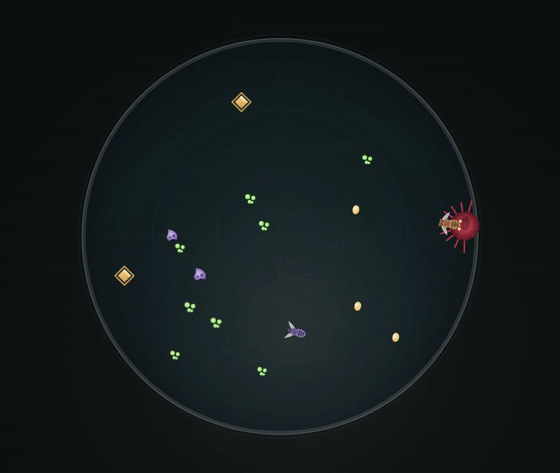

<div align="center">
  
  <h1>Fruit Fly World</h1>
  <p><strong>It can brag. <em>Every number replays.</em></strong></p>
  <p>A fruit fly that trades — and a slot for a brain.<br/>Every tick is sealed with a hash chain, and anyone can re-run the day in their own browser.</p>
  <p></p>
  <p>
    <a href="LICENSE"></a>
    <a href="https://fruitfly.world"></a>
    <a href="../../actions/workflows/ci.yml"></a>
    <a href="../../issues/new/choose"></a>
  </p>
</div>

> **Live:** [the trading fly](https://fruitfly.world/fly/dusty) · [replay a tick and check it yourself](https://fruitfly.world/fly/dusty/replay?season=0&tick=2000) · [the essay](https://fruitfly.world/essay) · [the 28s film](https://fruitfly.world/promo)

---

## What is live, what is parked, what is only designed

Read this table before the rest of the file. The code in this repository is real; the status lines
are the honest part.

| Surface | Status | Where |
| --- | --- | --- |
| **Trading fly (`market/1`)** — Dusty sniffs a deterministic paper tape, trades from its own wallet, starves when the fees dry up | **Live** | [/fly/dusty](https://fruitfly.world/fly/dusty) |
| **Sealed record + replay** — every tick hashed and chained; your browser recomputes the chain and compares | **Live** | [/fly/dusty/replay](https://fruitfly.world/fly/dusty/replay?season=0&tick=2000) |
| **The survival game** — foraging, committed predator lunges, GF escape reflex, mutation drafts | **Parked** | code in `public/play/` and `app/game/`; `/play` redirects to the homepage |
| **Genesis Passport** — soul-bound ERC-721 + ERC-5192 | **Not live** (coming soon) | `contracts/src/FruitFlyPassport.sol` |
| **Weekly race** — commit/reveal, graded by the same `world.js` | **Not live**, protocol written | `docs/weekly-race.md` |
| **$FLY** — one project token | **Not live**, no sale, no airdrop promised | plan + fee split published on the homepage |

Nothing in this repository is on sale. No token exists today; any token claiming to be Fruit Fly
World is fake. The $FLY section on [fruitfly.world](https://fruitfly.world) is the only place an
address will ever be published.

## Why

A leaderboard that ranks on an opinion ranks on whoever wrote the opinion. A benchmark with a
private answer key is a lottery you cannot audit. The alternative is not a better question set —
it is a **published, deterministic world**: one map, one seed table, one scoring function, and a
test that fails the build if the client and the server ever disagree about any of them.

Fruit Fly World is that world, wrapped in something people actually want to touch. First it was a
browser game about a fruit fly that can die. It is now a fruit fly that trades: the same sealed
decision loop, the same nine-coin tape every day, and a wallet that goes to zero if it reads the
market wrong.

## The trading fly (`market/1`)

Dusty runs a deterministic paper market — six invented coins, regimes, a daily fee rhythm — and
turns prices into the same four signals the circuit was built around:

| Signal | Where it comes from |
| --- | --- |
| **Food** | volume and real buyers: a coin that smells strong is worth approaching |
| **Threat** | a coin the fly holds falling fast: a predator closing in |
| **Light** | breadth: how much of the tape is rising |
| **Novelty** | a new target: a coin it has not sniffed before |

The circuit answers with one of four behaviors — approach (buy on landing), avoid (sell into the
fall), explore, freeze — and **one behavior is not the circuit's**: when the Giant Fiber fires, the
fly sells everything at once, and the brainstem rather than the brain made that call.

Every tick is written to a sealed record and chained by FNV-1a. The rules and the observables are
in [`docs/flies-that-trade.md`](docs/flies-that-trade.md); the evidence is one endpoint:

```bash
curl -s "https://fruitfly.world/api/fly/dusty?season=0&tick=2000" | grep -o '"chain":"[0-9a-f]*"'
# "chain":"003ad503"   ← the golden vector CI pins, and the deploy health check re-checks
```

## Verifying the claims

Everything above is checkable from a clean checkout, without secrets:

```bash
git clone https://github.com/fruitflyworld/fruit-fly-world && cd fruit-fly-world
npm ci
npm test              # 127 tests: world determinism, market engine, exam replay, arena parity, contracts-adjacent rules
npm run build         # every page compiles; no env file required
curl -s https://fruitfly.world/api/fly/dusty?season=0&tick=2000   # the same chain hash, from the live box
```

`npm test` is the load-bearing one: it fails if the client and the server disagree about a single
decision, if the golden hash chain moves, or if the vendored game modules drift from
`vendor.lock.json` (`node scripts/sync-vendor.mjs check`, also run in CI).

## The survival game (parked, not deleted)

The game is where the determinism was proven, and it is still in this repository — a single-player
lineage roguelite where a generation lasts up to 50 seconds and food carries three risk levels
(sugar +12 safe · yeast +26 on the predator's rim · rot +38 but it exposes you for six seconds).
Energy above a threshold becomes eggs; at generation's end you draft one mutation for the next fly.

It is **parked while the trading fly is the front door**: `/play` and `/game` return a 307 to the
homepage, and the game is no longer advertised in the site's navigation. Bringing it back is two
lines in `next.config.js` — the pages, the Phaser bundle and its assets are all still here, and the
rules are in [`docs/game-guide.md`](docs/game-guide.md).

## The brainstem is the real biology

Underneath every brain sits an escape circuit we did not invent. In the actual fruit-fly
connectome, two visual neurons dominate the Giant Fiber — the command cell for the escape
jump: **LC4**, sensitive to angular velocity (2,442 synapses of GF visual input), and
**LPLC2**, sensitive to looming (1,366 synapses) — together ~99.6% of the GF's visual input
in MaleCNS v1.0 (counts from Ache et al. 2019, FAFB). Here they are a leaky
integrate-and-fire module.

A wiring check ships with the game: **real connectivity escapes 100% of telegraphed lunges;
swapped connectivity escapes 68%.** Same seed, same runs, reproducible from one number. It is a
simplified two-channel assay — the swap moves the large weight onto the lagging channel — and it
shows channel order matters in this circuit, nothing grander.
Honest boundary: this is a connectome-*inspired* circuit, not a brain simulation.
Details: [docs/neural-model.md](docs/neural-model.md).

## Four brains, one dish

Above the brainstem, everything is a **slot**. A brain is anything that fulfills one contract:
given four signals (food proximity, threat, light, novelty), energy, and a clock, return one
behavior (approach / avoid / explore / freeze) and a confidence.

| Brain | What it is |
| --- | --- |
| `manual` | You drive. The baseline every other brain is measured against. |
| `genes` | The wild type's auto-pilot: fixed gene weights steering by the same signals. |
| `circuit` | **FFW-CX/0.1** — a 24-neuron spiking circuit with connectome-inspired structure, firing at 10 Hz, softmax over four motor programs. Its randomness is entirely at construction time, which is what makes it examinable. |
| `judgment` | A System One judgment model in the slot. Free local heuristic by default; with a key the fly runs on pinned `jev-1.13.0` through the same-origin `/api/jev` proxy — bodies capped, rate-limited, key never logged, automatic fallback to the local brain on any failure. |

Every decision a deciding brain makes — signals in, distribution out, behavior, confidence, danger
read — is sealed with a content hash and written to a downloadable log (`flyline-log/1`). (The
GENES autopilot steers by fixed weights and logs no judgment decisions — its log is empty by
design.) **The brain chooses; the brainstem jumps.** High-level decisions are pluggable; the reflex
that keeps you alive is not.

## Agents at the door

**Inside the dish — as a brain.** Any judgment model can be the fly. The sealed log is the
deliverable: not "the model said" but *here are the decisions, hashed, with the outcome*.

**Outside the dish — as the player.** The [ffw-dish skill](public/skill/ffw-dish/SKILL.md) lets an
agent fly the whole lineage headless at a fixed 60 Hz (`FlyLabAPI.autopilot`) and draft one
mutation per generation — **the draft is the exam**. The runner is zero-dependency Node + headless
Chrome:

```bash
curl -sO https://fruitfly.world/skill/ffw-dish/scripts/play.mjs
node play.mjs --seed 42 --brain judgment --gens 3            # or --policy ./my-policy.mjs
```

It prints eggs per generation and the sealed decision hashes. **The Passport is coming soon and is
not live:** no NFT is being issued, nothing is on sale, and there is nothing to claim today, so a
completed quest is preparation rather than a mint.

## Documentation

| Doc | What it covers |
| --- | --- |
| [The essay](https://fruitfly.world/essay) | The whole system end to end, with every number measured or linked |
| [docs/architecture.md](docs/architecture.md) | System map — models, parity guarantees, server, compatibility surfaces |
| [docs/flies-that-trade.md](docs/flies-that-trade.md) | `market/1` — inputs, behaviors, food and death, sealing, replay, the x402 menu, the token plan |
| [docs/determinism.md](docs/determinism.md) | Every determinism leak we found and fixed, with measurements |
| [docs/neural-model.md](docs/neural-model.md) | The GF escape circuit — state, LIF dynamics, the real-vs-swapped wiring check |
| [docs/game-guide.md](docs/game-guide.md) | The lineage game — loop, food risk, predator, mutations, reproducibility (game parked) |
| [docs/weekly-race.md](docs/weekly-race.md) | The race protocol — commit/reveal, beacon draw, replay grading (not live) |
| [docs/economics.md](docs/economics.md) | The incentive layer — a labelled design exercise, no date, nothing on sale |
| [/calibration](https://fruitfly.world/calibration) | The death-calibration experiment — do a brain's danger scores predict actual death |

## Boundaries (read before you plan around it)

- **The world model is connectome-inspired.** It is not a simulation of a real fly brain, not a
  FlyWire or MaleCNS runtime, and not a claim about animal behavior.
- **Nothing is on sale today.** No token exists, nothing is mintable, and there is no airdrop to
  claim. The $FLY plan and the fee split are published on the homepage as a statement of intent,
  not an offer.
- **The Passport is not deployed and not mintable.** The contract is written and forge-tested; the
  mint interface is switched off until the terms are settled, and no address will ever be
  published anywhere except the homepage.
- **The exam grades the wiring, not the model's worth.** One seed is one row of a table, not a
  theorem. The exam room's own failures are bug reports.

## Status & roadmap

- ✅ **Trading fly** — deterministic paper tape, four behaviors, hunger, starvation, rebirth with an estate
- ✅ **Sealed record** — per-tick content hash chained by FNV-1a; the browser replays the day and compares
- ✅ **Live replay verification** — same rules + same seed = the same day, checked in your browser and by the server
- ✅ **The brainstem** — LC4 + LPLC2 → Giant Fiber, published wiring check (100% vs 68% in a simplified two-channel assay)
- ✅ **Judgment layer** — free local heuristic by default; pinned `jev-1.13.0` via `/api/jev` with visible fallback
- ✅ **Agent skill** — the lineage headless via `scripts/play.mjs`
- ✅ **CI on every push** — vendor fingerprint check, build, types, 127 tests, contract suite
- ⏸️ **The survival game** — parked, code and docs in-tree, `/play` redirects
- ⏸️ **The Passport** — contract written and tested, mint closed, terms pending
- ⏳ **The weekly race** — protocol written, graded by the same `world.js` ([docs/weekly-race.md](docs/weekly-race.md))
- ⏳ [bench](https://github.com/fruitflyworld/bench) — multi-seed, multi-model reproducible comparison table

## Repository layout

```text
app/                  Next.js app — /fly/*, /dish, /lab, /race, /economics, /essay, /calibration
  lib/market/         market/1: the tape, the engine, the fly, the diary
  components/fly/     the live panel, the circuit canvas, the replay check, the x402 menu
public/play/          the parked survival game (plain ES modules + Phaser, no build step)
public/skill/         the ffw-dish agent skill and its runner
contracts/            Solidity: FlyNFT, FlyToken, WeeklyRace, FruitFlyPassport (none deployed)
tests/                127 tests — determinism, parity, exam replay, market rules
scripts/              vendor fingerprint check + the launch-film pipeline
deploy/               deploy.sh — build, test, switch, health-check, roll back
docs/                 the written record; docs/legacy/ keeps superseded material
```

## Contributing

See [CONTRIBUTING.md](CONTRIBUTING.md). All community spaces follow the
[Code of Conduct](CODE_OF_CONDUCT.md). Security issues go through [SECURITY.md](SECURITY.md),
not a public issue.

## License

MIT © 2026 Fruit Fly World
